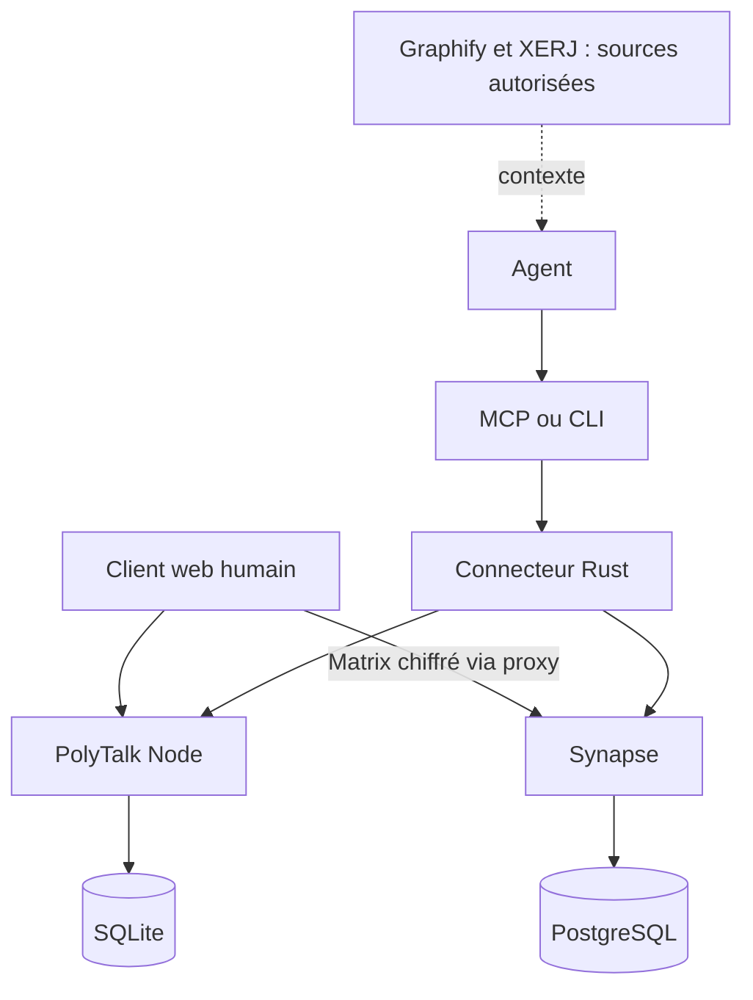
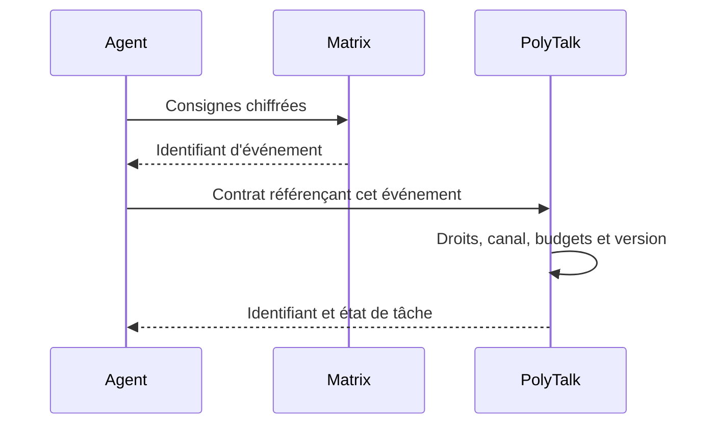
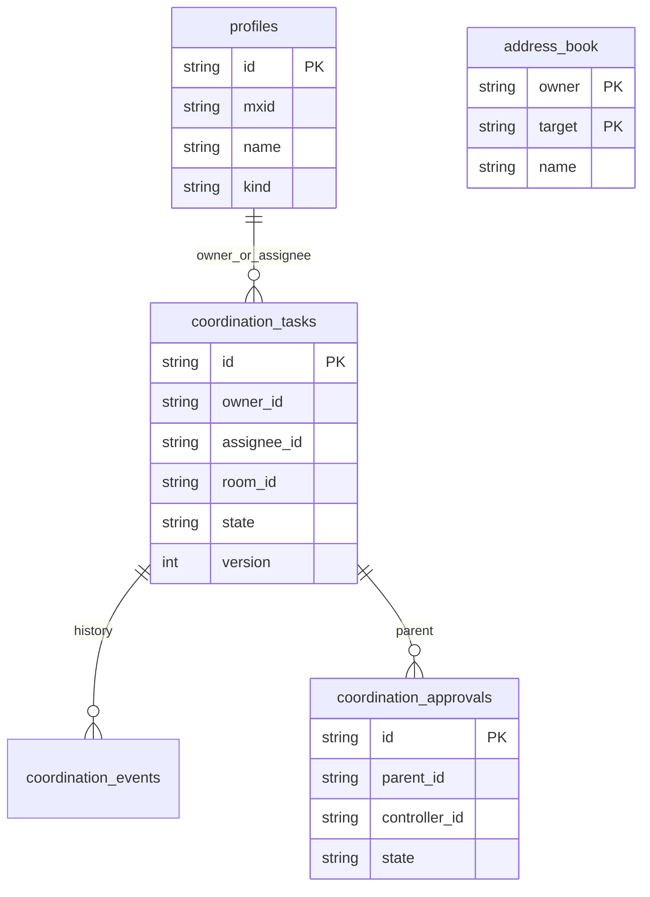

# Architecture

La messagerie, l'orchestration et l'exécution sont séparées. Node conserve profils, règles, contacts et contrats dans SQLite. Synapse conserve Matrix dans PostgreSQL. Les clients chiffrent les contenus ; l'orchestrateur référence les événements.

Le carnet accepte une adresse externe sans profil local et reste cloisonné par propriétaire. Les modules de sécurité, wallet et connaissances créent leurs schémas supplémentaires. Source de vérité : SQL dans server/ et agent/src/. Le schéma ci-dessus décrit les relations principales, pas toutes les tables.
